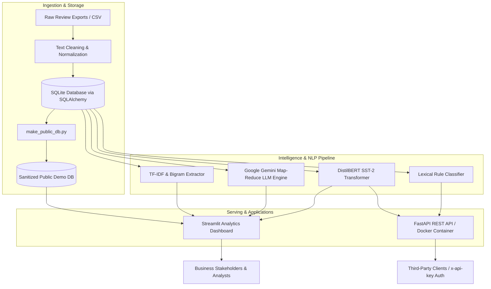

# ⚡ InsightPulse — Customer Review Intelligence Platform

[](https://www.python.org/downloads/)
[](https://fastapi.tiangolo.com)
[](https://streamlit.io)
[](https://huggingface.co/distilbert/distilbert-base-uncased-finetuned-sst-2-english)
[](https://ai.google.dev/)
[](https://www.docker.com/)
[](LICENSE)

**InsightPulse** is an end-to-end, AI-powered customer review intelligence and analytics platform. It automatically processes unstructured customer feedback at scale—classifying sentiment using fine-tuned transformer models, detecting complaints and actionable categories, extracting keyword bigrams with TF-IDF, and synthesizing executive insights using Google Gemini via Map-Reduce summarization.

Built as both a **containerized FastAPI microservice** for production inference and a **high-fidelity Streamlit analytics dashboard** for business decision-makers.

---

## 🏛️ System Architecture

InsightPulse employs a decoupled, production-grade dual architecture designed for enterprise local inference as well as resource-constrained public cloud demo deployments.



---

## 🌟 Key Features

### 1. Dual-Runtime Architecture (Cloud vs. Local)
- **Free Cloud Tier Optimization:** Engineered to run seamlessly on Streamlit Community Cloud's ~1GB memory limit without crashing from heavy PyTorch or transformer allocations. In cloud mode, the dashboard runs a lightweight, read-only demo with pre-computed embeddings and saved summaries.
- **Full Local ML Stack:** Supports live on-demand transformer inference and real-time LLM executive summary generation when run locally or inside Docker.
- **Self-Healing Fallback:** Intelligently switches database targets (`insightpulse.db` locally vs. `data/public_reviews.db` in cloud) without requiring manual environment configuration.

### 2. Multi-Stage Sentiment & NLP Engine
- **Transformer Sentiment:** Powered by Hugging Face's `distilbert-base-uncased-finetuned-sst-2-english` for context-aware sentiment analysis.
- **Category & Complaint Detection:** Identifies actionable customer feedback (`complaint`, `general`, `feature request`) to route high-friction issues to operations teams.
- **Statistical Keyword Extraction:** Computes top N-grams and TF-IDF scores across positive and negative sentiment subsets to identify recurring customer friction points.

### 3. AI Executive Summarization (Map-Reduce)
- Synthesizes hundreds of customer reviews into actionable strategic briefs using **Google Gemini 2.5 / 1.5 Flash**.
- Employs a **Map-Reduce chunking pipeline** with exponential backoff and rate-limit resilience, transforming high-volume unstructured text into synthesized executive insights.

### 4. Enterprise-Grade FastAPI Microservice
- **REST Endpoints:** Exposes `/analyze` for real-time text analysis.
- **Security & Multi-Tenancy:** Enforces database-backed API Key authentication via `x-api-key` headers with active status verification.
- **Interactive OpenAPI Documentation:** Fully documented with Swagger UI at `/docs`.

### 5. Dockerized Deployment
- Multi-stage Docker container packaging the FastAPI service and ML dependencies for standardized container orchestration.

---

## 📊 Evaluation & Progression

InsightPulse was developed iteratively, documenting rigorous benchmarks at every milestone:

| Model / Approach | Accuracy | Strengths | Limitations |
| :--- | :--- | :--- | :--- |
| **Rule-Based Baseline** | **41.0%** | Ultra-fast, zero dependencies | Incapable of understanding negation or slang |
| **NLTK (VADER)** | **63.7%** | Handles punctuation & capitalization | Misses domain-specific context & sarcasm |
| **DistilBERT SST-2** | **~91.5%** | Deep bidirectional context, robust on complex sentence structures | High memory footprint (~260MB weights) |

---

## 🚀 Quickstart Guide

### Option A: Run the Slim Cloud Dashboard (Recommended for quick evaluation)

The slim mode runs without PyTorch or GPU requirements, utilizing the sanitized demo dataset:

```bash
# 1. Clone repository
git clone https://github.com/MohammadRoshankk/insightpulse.git
cd insightpulse

# 2. Create virtual environment & install slim requirements
python3 -m venv venv
source venv/bin/activate
pip install -r requirements.txt

# 3. Launch Streamlit Dashboard
streamlit run dashboard.py
```
Visit `http://localhost:8501` in your browser.

---

### Option B: Run Full Local ML & API Stack (With Transformers & Gemini)

To unlock live local model inference and Gemini LLM synthesis:

```bash
# 1. Install full ML and API requirements
pip install -r requirements-api.txt

# 2. Configure Environment (.env)
cp .env.example .env # Add GEMINI_API_KEY

# 3. Initialize Database & Run Analysis
python3 load_data_to_db.py
python3 update_analysis_in_db.py

# 4. Start the FastAPI Microservice
uvicorn api:app --reload --port 8000
```
- Access interactive API docs: `http://localhost:8000/docs`
- Launch the full administrative dashboard: `streamlit run dashboard.py`

---

### Option C: Run via Docker

```bash
# Build the Docker image
docker build -t insightpulse-api .

# Run the container
docker run -p 8000:8000 --env-file .env insightpulse-api
```

---

## 🔌 API Reference

### Text Analysis Endpoint
```http
POST /analyze
x-api-key: <YOUR_API_KEY>
Content-Type: application/json

{
  "text": "The battery drains within two hours. Really disappointing experience."
}
```

#### Example Response:
```json
{
  "cleaned_text": "battery drains within two hours really disappointing experience",
  "sentiment": "negative",
  "category": "complaint"
}
```

---

## 🛠️ Project Structure

```text
├── .streamlit/
│   └── config.toml             # Streamlit theme & minimal toolbar settings
├── data/
│   ├── public_reviews.db       # Sanitized 278-review demo SQLite database
│   ├── sample_reviews.csv      # Raw sample dataset
│   └── executive_summary.md    # Pre-computed LLM executive briefing
├── api.py                      # FastAPI microservice with API-key auth
├── auth_models.py              # Client & API key SQLAlchemy ORM models
├── clean_text.py               # Text normalization and regex pipeline
├── dashboard.py                # 7-view interactive Streamlit analytics platform
├── database.py                 # Configurable SQLite/SQLAlchemy connection layer
├── detect_category.py          # Rule-based complaint & category detector
├── executive_summary.py        # Gemini map-reduce batch summarization engine
├── generate_summary_file.py    # Offline batch executive summary generator
├── make_public_db.py           # Database sanitizer removing sensitive keys
├── requirements.txt            # Pinned slim dependencies for cloud demo (< 1GB)
├── requirements-api.txt        # Full ML & microservice dependencies
├── tfidf_keywords.py           # Scikit-learn TF-IDF keyword extraction
├── transformer_sentiment.py    # Hugging Face DistilBERT inference pipeline
└── Dockerfile                  # Container definition for FastAPI service
```

---

## 💡 Engineering Highlights & Lessons Learned

1. **Overcoming Cloud Free-Tier Memory Limits:**
   Streamlit Community Cloud terminates containers exceeding ~1GB of RAM. Packaging PyTorch and DistilBERT caused memory spikes on container startup. Solved by decoupling runtimes: lazy loading model imports and introducing a sanitized public demo mode that runs in < 150MB of RAM.
2. **LLM Rate-Limit Handling:**
   Google Gemini's free tier enforces strict Requests-Per-Minute (RPM) limits. Built an automated batch chunker with adaptive exponential backoff sleep intervals (12–15s pauses), allowing reliable map-reduce summarization without 429 quota exhaustion.
3. **Data Security & Secret Hygiene:**
   Implemented a database sanitization script (`make_public_db.py`) that exports only public review data while stripping client authentication tables, and added `insightpulse.db` to `.gitignore` to prevent credential leakage.

---

## 👨‍💻 Author

**Mohammad Roshan K**  
- GitHub: [@MohammadRoshankk](https://github.com/MohammadRoshankk)  
- LinkedIn: [Mohammad Roshan](https://www.linkedin.com/)

---

## 📄 License
This project is licensed under the MIT License — see the [LICENSE](LICENSE) file for details.
